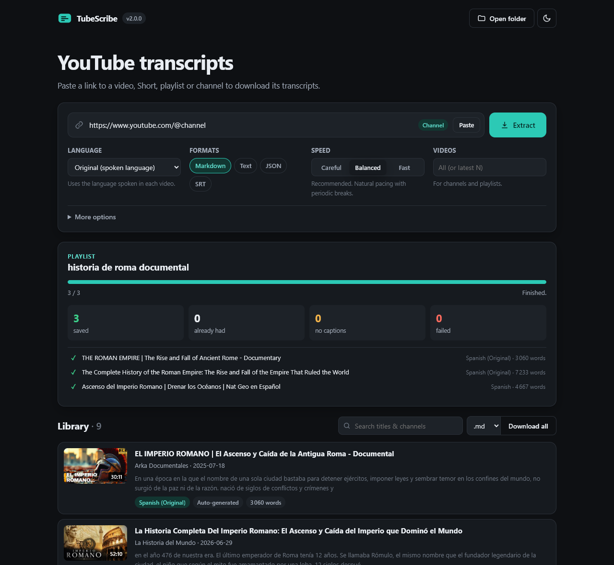
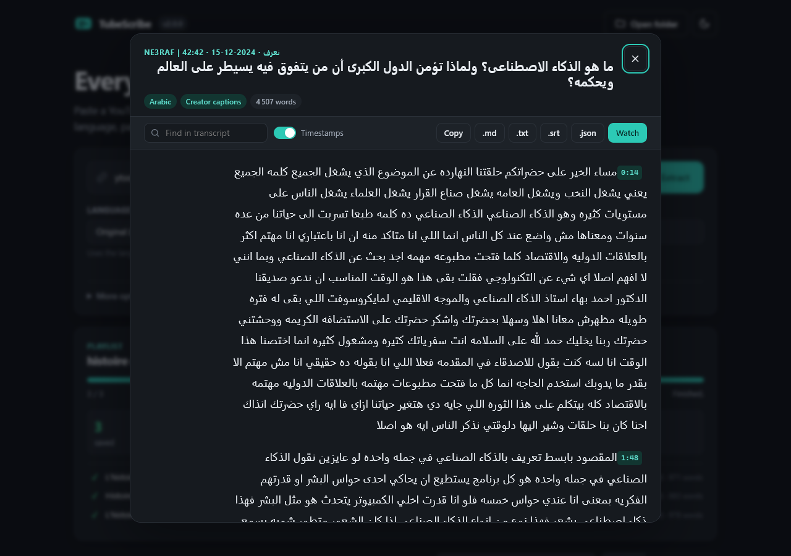
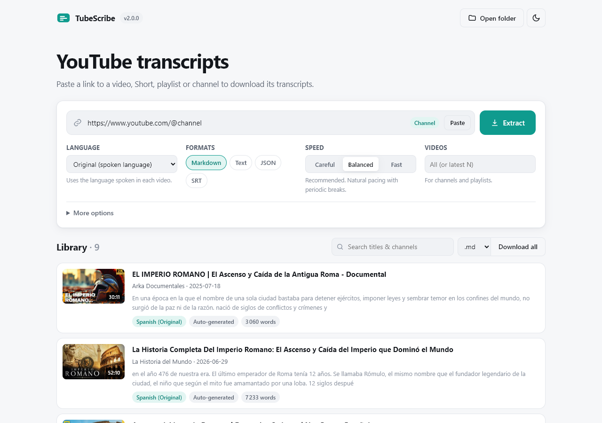

# TubeScribe

Download transcripts from YouTube videos, Shorts, playlists and whole channels, in any language. Comes with a local web UI, a CLI, and a Windows exe.

[](https://github.com/mohammed-essanaani/tubescribe/actions/workflows/ci.yml)
[](https://github.com/mohammed-essanaani/tubescribe/releases/latest)
[](LICENSE)



## Features

- Uses the language spoken in each video by default, or a language you choose. Creator captions are preferred over auto-generated ones, and YouTube's translation is used as a last resort.
- Works with Arabic, Hebrew and other right-to-left languages, and with Chinese and Japanese (no spaces between words).
- Random delays between requests, longer breaks every batch, backoff on HTTP 429, and the job stops if YouTube keeps refusing.
- Videos already downloaded are skipped, so running a channel again only fetches new uploads.
- Splits the text into paragraphs and removes duplicated caption lines and tags like `[Music]`.
- Exports Markdown (with YAML front matter), TXT, JSON and SRT.

| Reader | Light theme |
|---|---|
|  |  |

## Install

**Windows:** download `TubeScribe.exe` from [Releases](https://github.com/mohammed-essanaani/tubescribe/releases/latest) and run it. The app opens in your browser and saves transcripts to a `transcripts` folder next to the exe. The exe isn't code-signed, so Windows may show a SmartScreen warning.

**From source** (Python 3.10+):

```bash
git clone https://github.com/mohammed-essanaani/tubescribe.git
cd tubescribe
pip install -e .
tubescribe
```

## CLI

```bash
tubescribe get https://www.youtube.com/@channel
tubescribe get @channel --limit 20 --lang fr --format md,srt --timestamps
tubescribe get "https://www.youtube.com/playlist?list=..." --speed careful --cookies-from-browser firefox
tubescribe langs https://youtu.be/VIDEO_ID
```

| Option | |
|---|---|
| `-l, --lang` | Preferred languages, e.g. `ar,en`. Default `orig` (the video's spoken language) |
| `--no-translate` | Don't use YouTube's machine translation |
| `--manual-only` | Only use captions uploaded by the creator |
| `-f, --format` | `md`, `txt`, `json`, `srt` |
| `-t, --timestamps` | Add timestamps to paragraphs |
| `-n, --limit` | Only the latest N videos |
| `-s, --speed` | `careful`, `balanced` (default), `fast` |
| `--force` | Download again even if already saved |
| `-o, --output` | Output folder (default `./transcripts`) |
| `--cookies`, `--cookies-from-browser` | Use cookies, helps with large channels |
| `--proxy` | HTTP or SOCKS proxy |

## Rate limiting

| Speed | Delay between videos | Break |
|---|---|---|
| careful | 5 to 11 s | every 15 videos |
| balanced | 2.5 to 6 s | every 30 videos |
| fast | 1 to 2.5 s | every 60 videos |

After a 429 the tool waits about 30 and then 60 seconds before retrying, and slows down for the rest of the job. If two videos in a row still fail, the job stops. For big channels use `careful` and `--cookies-from-browser`.

YouTube rate limits translated captions a lot more than normal ones. When a translation fails, the original language is saved instead.

## Project structure

```
tubescribe/
  cli.py         command line
  server.py      FastAPI server for the web UI (progress over SSE)
  pipeline.py    runs a job: fetch, retry, save
  throttle.py    delays and backoff
  youtube.py     yt-dlp wrapper
  languages.py   picking the caption track
  parsers.py     json3 and VTT parsing
  text.py        cleaning and paragraphs
  exporters.py   md, txt, json, srt
  storage.py     saved files and the library index
  web/           HTML, CSS, JS
tests/
```

## Development

```bash
pip install -e ".[dev]"
pytest
ruff check .
```

Build the exe:

```bash
pip install -e ".[build]"
pyinstaller tubescribe.spec --clean
```

## License

MIT. This project is not affiliated with YouTube. Respect creators' rights and YouTube's terms when using it.
